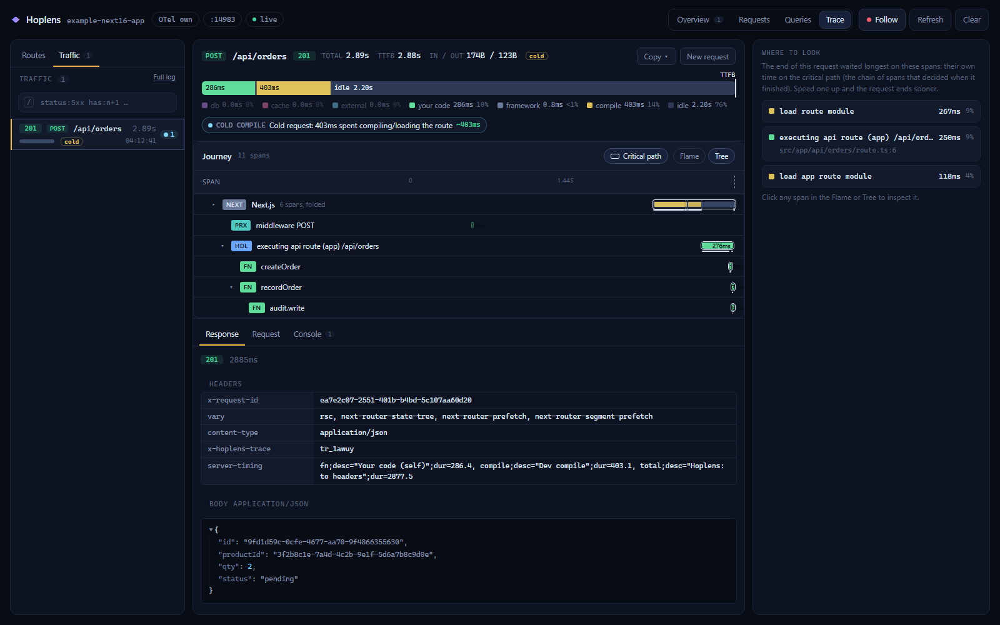

# Hoplens

[](https://www.npmjs.com/package/hoplens)
[](https://github.com/hermandinho/hoplens/actions/workflows/ci.yml)
[](./LICENSE)

> One command, and `next dev` gains a page that shows every request's full
> hop-by-hop journey — proxy → router → handler → your functions → fetch/DB
> → response — with errors pinned to the exact `.ts` line and a request
> builder that pre-fills bodies from your Zod schemas.



## Install

```bash
npm i -D hoplens
npx hoplens init     # wires withHoplens() + instrumentation.register()
npm run dev
# open http://localhost:3000/__hoplens
```

Requires Next.js 15.3+ and Node 20.9+. Next 16 is the primary target.

## What you get

- **The whole journey.** Every request becomes a timeline of hops: middleware,
  router, your handler, each exported function it calls, outbound `fetch` /
  DB queries, the response. Timings, args, return values, logs — all on one
  canvas.
- **Errors pinned to the line.** When a hop throws, click it and the inspector
  shows the exact `.ts` line that blew up with the full stack. Source peek
  opens the file inline — no IDE round-trip.
- **Request builder with static Zod pre-fill.** Hoplens reads your `z.*`
  schemas from source (no code execution) and pre-fills example bodies for
  every route. Edit, hit **Send**, watch the trace stream in.
- **OpenTelemetry-native.** If you already run OTel, Hoplens attaches as a
  reader — it doesn't replace your provider. If you don't, Hoplens runs
  standalone.
- **Dev-only, guaranteed.** The instrumentation hook is gated by
  `NODE_ENV === "development"` and the production build is CI-asserted to
  contain zero Hoplens runtime. Shipping impossible.

## Commands

```text
hoplens init     wire Hoplens into next.config and instrumentation
hoplens doctor   check that everything is wired correctly
hoplens remove   unwire Hoplens from this project (reverse of init)
```

All three support `--dry-run`. Run `npx hoplens <cmd> --help` for details.

## Monorepo layout

```
packages/
  meta/        hoplens              unscoped meta — depends on cli, next, core
  cli/         @hoplens/cli         bin `hoplens` (init / doctor / remove)
  next/        @hoplens/next        withHoplens, Next route scanner, proxy detect
  core/        @hoplens/core        framework-agnostic runtime, OTel bridge
  schema/      @hoplens/schema      static Zod reader
  transform/   @hoplens/transform   exported-fn rewriter + loader + register hook
  ui/          @hoplens/ui          Preact + Vite single-HTML dashboard
examples/
  next16-app/                       Turbopack + proxy.ts + Zod v4
e2e/                                Playwright suite + install-flow smoke
```

See [`AGENTS.md`](./AGENTS.md) for architecture notes and the lessons that
shaped the design.

## Development

```bash
pnpm install
pnpm -r --filter "./packages/**" build
pnpm -r --parallel run test
pnpm -r --parallel run typecheck
pnpm --filter example-next16-app dev    # try the UI against the live example
```

End-to-end checks (opt-in, slow):

```bash
pnpm --filter hoplens-e2e install:browsers   # one-time
pnpm --filter hoplens-e2e e2e                # Playwright screenshot suite
pnpm --filter hoplens-e2e verify:build       # prod build has no Hoplens leaks
pnpm --filter hoplens-e2e verify:install     # pack → scratch install → init → doctor
```

## License

MIT © Hoplens contributors. See [LICENSE](./LICENSE).
