# Hoplens

[](https://www.npmjs.com/package/hoplens)
[](https://github.com/hermandinho/hoplens/actions/workflows/ci.yml)
[](./LICENSE)

Hoplens is a dev-only request-journey view for Next.js and Express: every request your dev server
handles becomes a tree of hops (proxy, router, handler, your own functions, fetch, DB and Redis
calls, the response) at `/__hoplens`. Each request opens with one sentence saying what made it slow
or fail and the line to look at, and the Changes view tells you whether your last edit made a route
slower.


## Quick start

### Next.js

```bash
npm i -D hoplens
npx hoplens init     # wraps next.config with withHoplens() and adds hoplens/node to instrumentation register()
npm run dev          # next dev, unchanged
# open http://localhost:3000/__hoplens
```

Requires Next.js 15.3+ and Node 20.9+. Next 16 is the primary target.

### Express

```bash
npm i -D hoplens
npx hoplens init     # "dev": "node --watch src/server.js" -> "node --watch --import hoplens/express/register src/server.js"
npm run dev
# open http://localhost:<your port>/__hoplens   (also served standalone on http://127.0.0.1:4983)
```

Express support lands in the next release: `hoplens@0.3.1` on npm has no `hoplens/express`
entries yet (unreleased on npm).

Requires Express `>=4.18 <6` and Node 20.9+. `init` edits only one script: `scripts.dev`, else
`start:dev`, else `watch`. It handles `node [--watch]`, `tsx [watch]` and `nodemon`, keeps env
prefixes and `&&` chains as written, and in a terminal asks whether to turn on the request path
(default no):

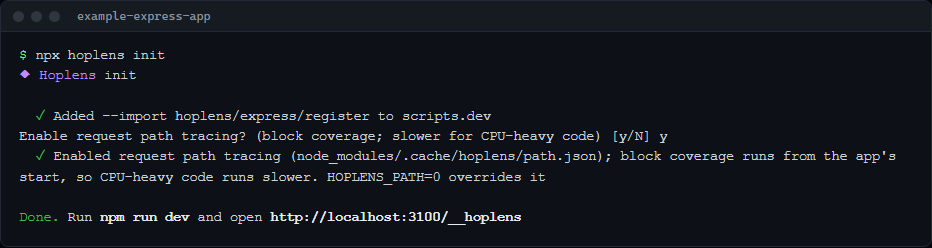

When the app starts, the banner prints the URL, how many functions are wrapped as hops and, when it
is on, the request path:

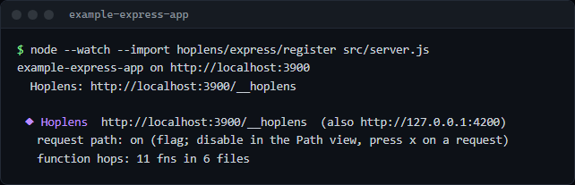

Not using the CLI? Preload the hook yourself (`node -r hoplens/express/register server.js` or
`node --import hoplens/express/register server.mjs`) or call `hoplens(app)` from
`hoplens/express`. The [`@hoplens/express` README](./packages/express/README.md) covers both.

## Tour

The UI has four views, each a list beside the thing you picked: Overview, Requests, Queries and
Changes (keys `1` to `4`). The URL hash holds the state, so every screen has a link and Back /
Forward work. Press `?` for the keys that work where you are, and `Ctrl+K` (`Cmd+K` on mac) for the
command palette.

### Overview

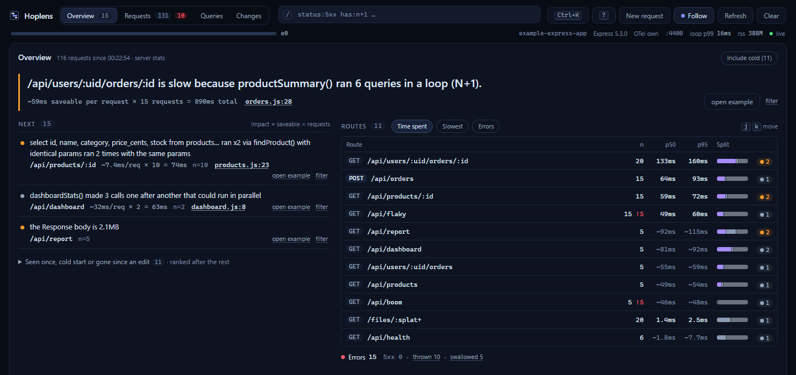

The Overview (`#/`) leads with the top problem across all requests in one sentence, here an N+1 that
would save about 59ms on each of 15 requests. Below it, the next findings ranked by saveable ms per
request x requests, routes by time spent with n, p50, p95 and a per-edit p50 delta, and one errors
line that splits 5xx, thrown and swallowed errors. A route opens with fast, typical and slow example
requests.

### The request journey


An open request (`#/r/<id>`) shows its verdict, Where to look, the time budget split into db, cache,
ext, fn, framework, compile and idle, and the canvas. The canvas has three modes: **Flame** (nested
boxes, width is duration, with a minimap, the critical path and idle gaps), **Tree** (one indented
row per span; `t` toggles the two) and **Path** (`x`, see [Request path](#request-path)). Under it,
Response, Request, Console and Span tabs hold the bodies, headers, logs, args and return values.
Dev responses also carry a `Server-Timing` header (db, cache, ext, fn, compile, total) and
`x-hoplens-trace: <id>`, so the browser's Network panel shows the same split.

On Next, the framework's own spans (`BaseServer.handleRequest`, route loading, dev compile) are
folded so your proxy, handler, functions and DB calls stand out:

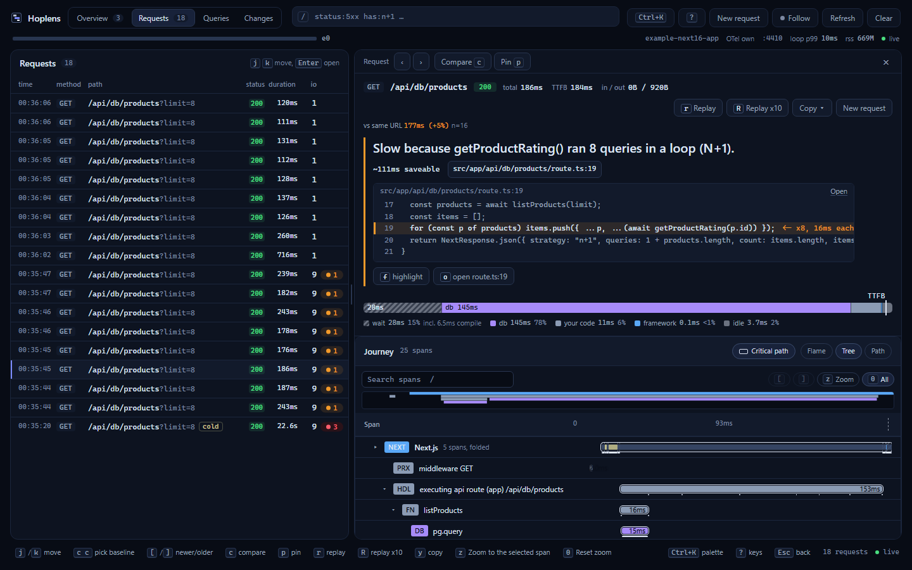

### Findings with code locations

![Tree mode on GET /api/products/7 with the second findProduct call selected: the duplicate finding in Where to look and the Span tab with products.js:9, args [7] and the return value](./docs/images/tree-function-hops.png)

Nine rules run after each response: N+1 (`n-plus-1`), duplicate calls (`duplicate`), sequential
calls that could run in parallel (`parallelizable`), slow functions (`slow-fn`), uncached fetches
(`fetch-uncached`), cold compiles (`cold-compile`), large payloads (`large-payload`), errors caught
inside a success (`swallowed-error`) and warn / error logs on a success (`logs-on-success`). Each
finding points at a file and line: an N+1 at the call inside the loop, a duplicate at the repeated
call. Your exported functions are hops of their own, at their file and line, with args and return
value, so a finding an exported function owns is located at that function. `f` highlights the
verdict's cause and `o` opens its source.

### Errors pinned to the line

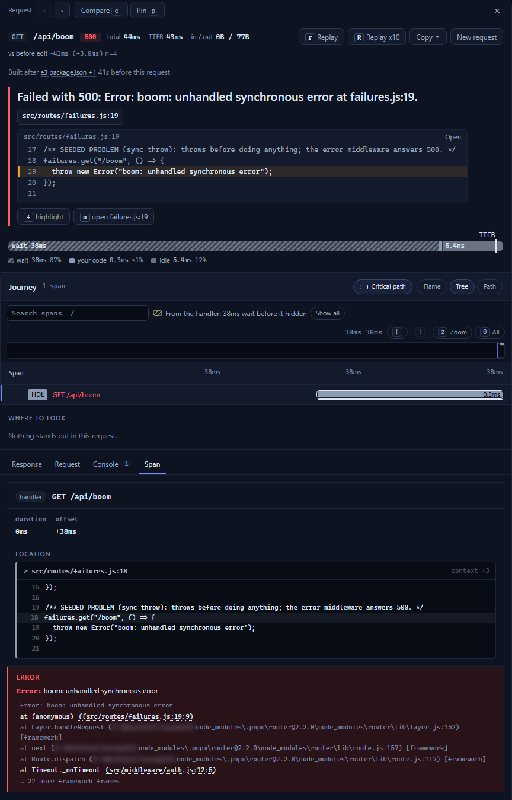

A thrown error carries its source line and the mapped stack (TypeScript, Turbopack and webpack
source maps included); the source opens inline, no IDE round-trip. An error caught inside a `200`
reads "Failed silently". Uncaught exceptions and unhandled rejections in the dev server are collected
too, next to event-loop delay and memory in the top bar. Next's dev 500 has an empty body, so the UI
says the error lives in the journey.

### Changes across edits and restarts

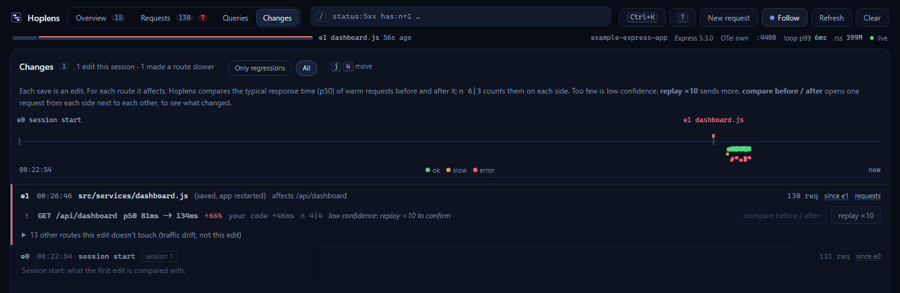

Every edit is an epoch, attributed to the files you saved and the routes that import them. On Next
an epoch is a dev rebuild; on Express under `node --watch`, `tsx watch` or nodemon it is a restart
that changed code, found by comparing token-level source hashes with the previous process's
manifest (a format-on-save or a `touch` is not an edit). Changes (`#/changes`) lists each edit with a
per-route verdict on warm p50 over the URLs both sides share, and a toast names a route that just got
slower. Across restarts this needs `persist`, which is on by default for Express and off for Next.

### Compare

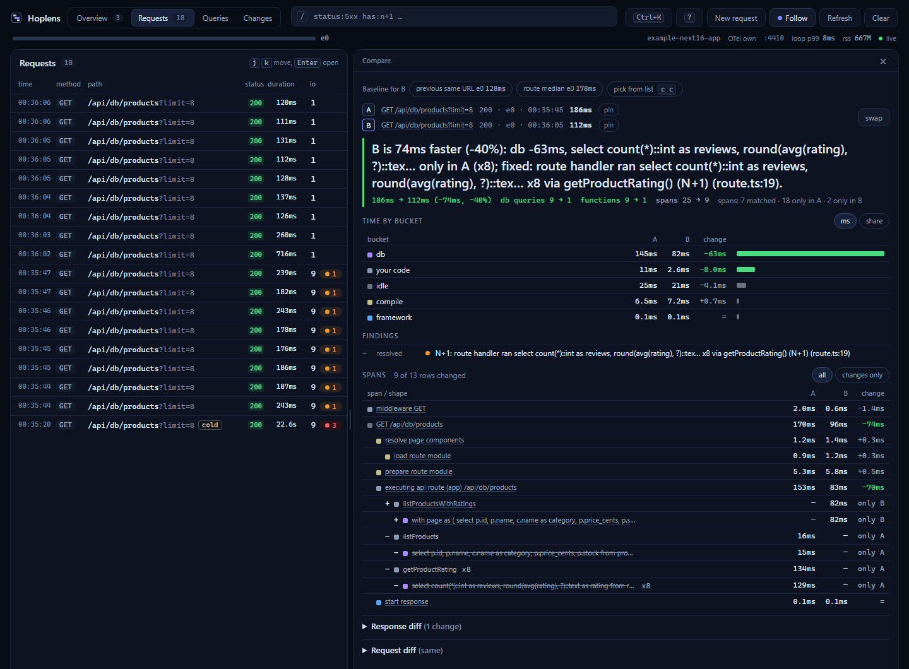

`c` compares the open request with a default baseline (the previous build, the same URL, or the
route median), `c c` lets you pick one, and `d` diffs against the previous build. Compare
(`#/cmp/<a>..<b>`) shows the time by bucket, findings resolved and new, matched spans with their
call counts (`x10 -> x1`) and spans only in A or only in B, plus the bodies side by side. Traces live
in memory, so compare needs both requests in one process: a Next hot reload, not an Express restart.

### Request builder and replay

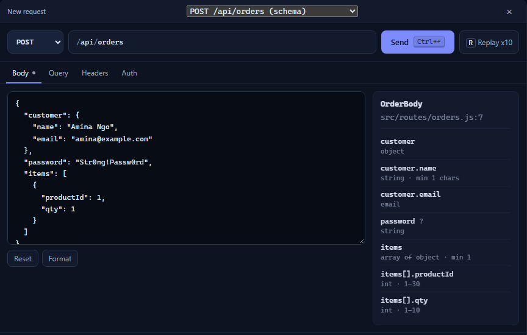

`b` opens the builder with every discovered route. Hoplens reads your `z.*` schemas from source,
statically and without running your code, and pre-fills an example body, query and params: from
Next route handlers, and from Express handlers or validation middleware at the line that registered
the route. Auth profiles from the `profiles` option add headers (`${ENV_VAR}` is replaced at send
time). `r` replays a request once and `R` replays it x10 for a warm p50 / p95 against the previous
batch; `y` copies it as curl, `fetch()` or a Vitest test.

### Queries

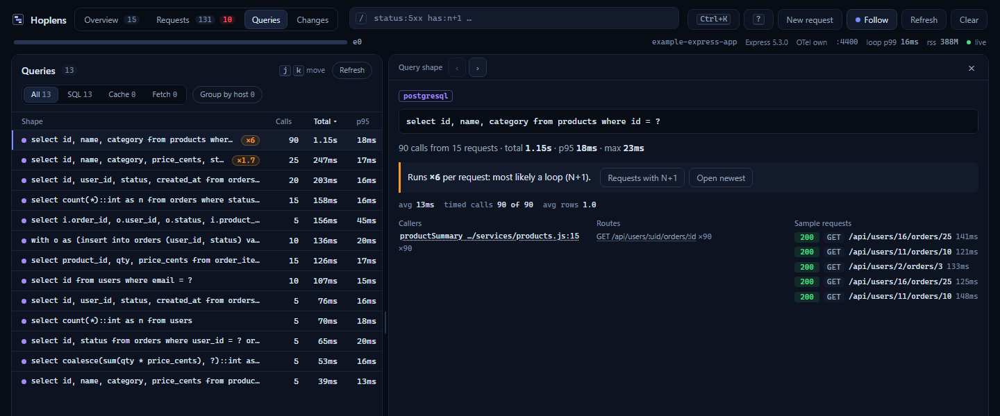

Queries (`#/queries`) lists every db, cache and fetch call shape across requests, with literals
normalized: calls, total time, p95, errors, the routes and functions that call it, and loop counts.
A shape (`#/q/<shape>`) shows its callers at file and line and sample requests to open. Fetches can
be grouped by host.

### Request path

The request path answers "which branch did this request take". **Trace path** replays a GET or
HEAD request once, alone, as a new trace, and reports block by block which handler and function code
ran, from V8 block coverage. The trail lists each function as a lane with its decisions (`if` /
`else`, `switch` cases, `?:`, `&&` / `||` / `??` that guard a call, `try` / `catch`, loop passes)
and a verdict line for where the request exited:

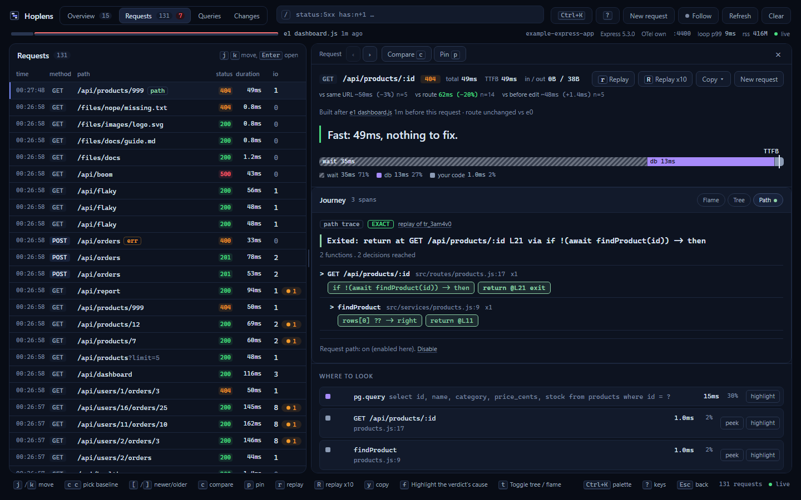

Click a lane (or `Enter`) for the function's **Flow** chart beside the trail: the taken arm is
solid, an arm that did not run is dashed, and lines that did not run fold away. `Backspace` goes back
to the caller, `j` / `k` move between lanes:

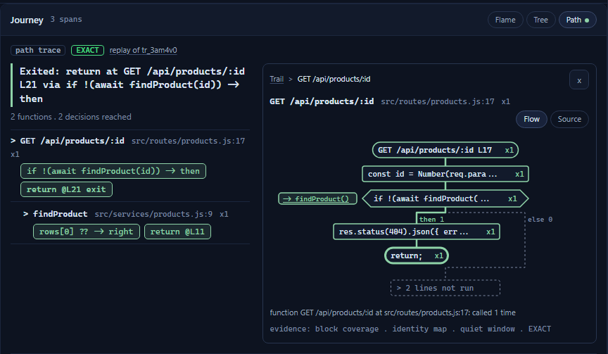

`v` switches to the **Source** gutter: per-line hit counts with the decision chips on the lines
they belong to (`u` unfolds everything):

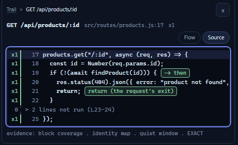

An arm reads taken only when it really ran; anything the counts cannot prove (code after a callee
threw, an await still pending, a file edited since the app started) is unknown, with the reason.
The capture waits for the app to be idle and retries once if other work ran in the window.

The request path is off by default, because coverage must start before your app loads and makes
CPU-heavy code slower. Three ways to turn it on, all applied at the next start:

- **Path view:** press `x` on a GET request and click **Enable request path**. It writes a flag
  file (`node_modules/.cache/hoplens/path.json` on Express, `.next/cache/hoplens/path.json` on
  Next) and shows *Restart your dev server to apply*; the footer's **Disable** link removes it.
- **`hoplens init`:** answer `y`, or pass `--path` / `--no-path`.
- **`HOPLENS_PATH=1`** (or `0` to keep it off). The env var always wins over the flag.

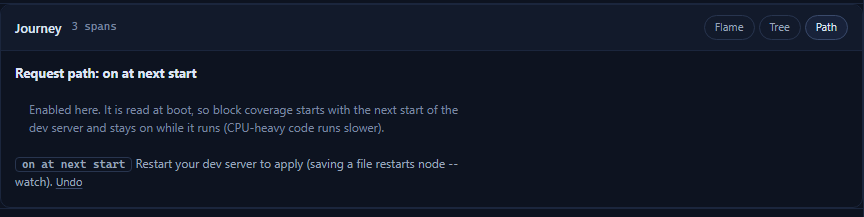

Under `NODE_V8_COVERAGE` (c8) it stays off. Express details, including tsx and CommonJS, are in
the [`@hoplens/express` README](./packages/express/README.md#trace-path-request-path); Next details
(Turbopack HMR updates, `HOPLENS_PATH_DEBUGGER`) in the [`@hoplens/next`
README](./packages/next/README.md#request-path-trace-path).

### Command palette and search

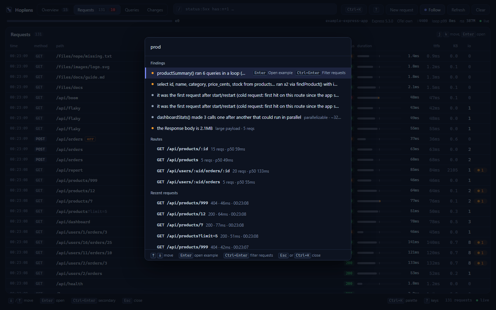

`Ctrl+K` finds findings, routes, recent requests, query shapes, edits, views and actions, matched
fuzzily (the server search also covers logs and bodies). The request list's query bar takes AND-ed
terms, and a leading `-` negates one:

```text
status:5xx  status:404  status:>=400  status:400..499  status:404,500
dur:>200  dur:<=50ms  dur:>1.5s  dur:100..500        (bare number = at least)
route:/api/*  route:/api/orders                       (glob; no * = exact or path prefix; route:/ is only /)
method:POST  method:get,put     kind:route  kind:page,action
has:n+1  has:error  has:findings  has:<rule id>       cold:true  cold:false
timeout  "connection refused"  text:"upstream 503"    (free text; the server also searches logs and bodies)
-status:2xx  -"health"
```

The grammar ships as the pure `@hoplens/core/query` subpath (`parseQuery`, `matchQuery`,
`compileGlob`).

### Phones

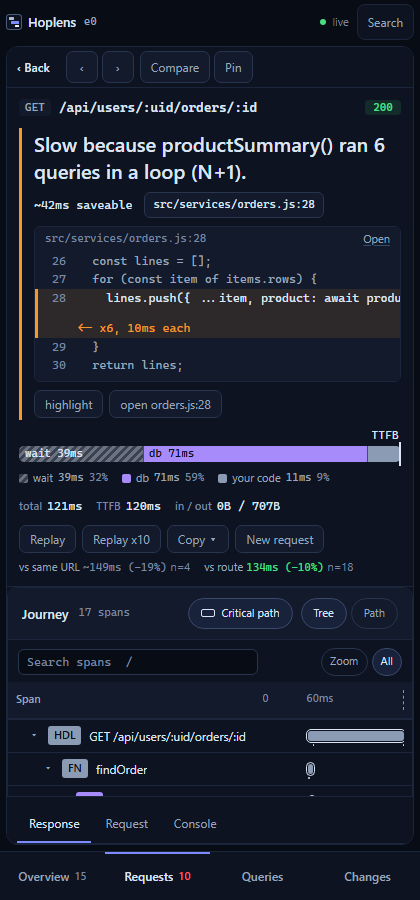

At 760px and below the list and the subject are separate pages with bottom tabs. On touch phones
the key hints are hidden.

### Keyboard

| Where | Key | Does |
|---|---|---|
| anywhere | `1` `2` `3` `4` | Overview, Requests, Queries, Changes |
| | `/` | Filter the list |
| | `b`, `R` (in the builder) | Open / close the request builder, replay the builder's request x10 |
| | `s`, `e`, `E` | Toggle the since-last-edit scope, scope to an older, a newer edit |
| | `Ctrl+\` | Collapse / expand the list |
| | `Esc` | Close the drawer, then clear the filter or scope, then close the subject |
| lists | `j` / `k` | Next / previous row (the open subject follows) |
| | `Enter`, `Space` | Open, peek the request under the cursor |
| a request | `[` / `]` | Newer / older request |
| | `f`, `o` | Highlight the verdict's cause, open the culprit's source |
| | `c`, `c c`, `d` | Compare with the default baseline, pick the baseline, diff against the previous build |
| | `p` | Pin it (kept past the ring buffer) |
| | `r`, `R` | Replay once, x10 |
| | `y` | Copy as curl, `fetch()` or a Vitest test |
| | `t`, `x` | Flame / Tree, Path view |
| | `z`, `0` | Zoom to the selection (or the handler), reset zoom |
| the canvas | `[` / `]`, `/`, `n` / `N` | Pan, search spans, next / previous match |
| the path trail | `j` / `k`, `Enter` | Next / previous lane, open the lane's function |
| a path function | `v`, `u`, `Backspace`, `Esc` | Flow / Source, unfold everything, back to the caller, close |

## How it works

Everything downstream of the HTTP tap is framework-neutral. The adapters tell core what to ignore,
which routes exist (a `DiscoverySource`) and how to recognise their requests (an `HttpTap`); the
runtime never imports a framework.

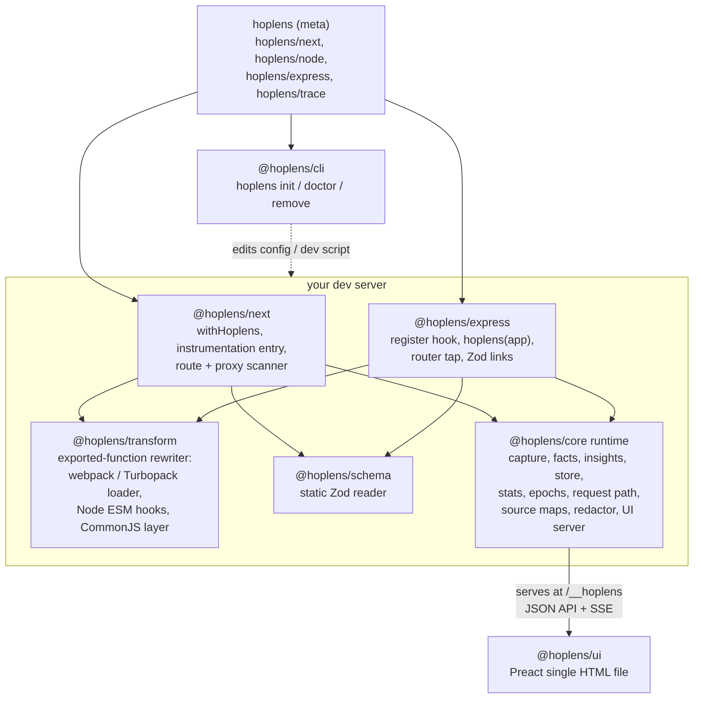

A request is captured on the app's own `http.Server`, and everything after the response runs off
the request path:

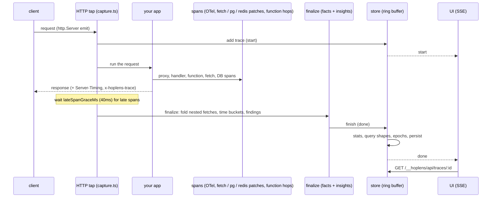

The request-path work (facts, findings, stats, persistence) is measured, not assumed: the bench
gates the whole pipeline under 2ms per request and Server-Timing under 0.5ms. Function hops come
from a rewrite that appends a trailer to your module and never moves a line, so stack traces and
breakpoints land where they did. [`AGENTS.md`](./AGENTS.md) has the architecture notes and the
lessons that shaped the design.

## Supported

| | Next 16 | Next 15.3+ |
|---|---|---|
| Turbopack | full | everything except function hops (use `--webpack`) |
| Webpack (`--webpack`) | full | full; middleware hops not available (edge sandbox) |

App Router and Pages Router API routes. Edge runtime routes are listed, not traced. Next 16's
`proxy.ts` runs on Node and is traced.

Express 4 and 5 (`>=4.18 <6`), ES modules and CommonJS, JavaScript and TypeScript. Function hops
work with these runners:

| Runner | Node |
|---|---|
| `node [--watch] --import hoplens/express/register` (a CommonJS entry itself loads untouched; use `-r` to wrap it) | 20.9+ |
| `node -r hoplens/express/register` | 20.9+ |
| `.ts` / `.cts` that Node strips itself | 22.18+ (22.6+ with `--experimental-strip-types`) |
| `tsx [watch] --import hoplens/express/register` (what `init` writes), `node --import tsx --import hoplens/express/register` | 20.11+; on 20.9 / 20.10 the same hops, read from the file on disk |
| `node --import hoplens/express/register --import tsx`, any `-r` with tsx | 20.9+ |
| `node -r ts-node/register -r hoplens/express/register` | 20.9+ |
| `node dist/server.js` (tsc output) | 20.9+, with `autoTrace.include: ["dist/**"]` |

The `runner-matrix` CI job runs these on Node 20.9.0, the latest 22.x and the latest 24.x, on Linux
and Windows. The full table and the rules behind it are in the [`@hoplens/express`
README](./packages/express/README.md#function-hops).

## Instrumentation

Out of the box: Next's own OTel spans, Express route templates and handler hops, your exported
functions (via the transform), `globalThis.fetch` (with Next data-cache and CDN cache attribution),
`pg` (node-postgres, `Pool` included), `postgres` (postgres.js, resolvable from the app root),
`ioredis` and `node-redis` v4+, Prisma with its OTel instrumentation, and any OTel span with `db.*`
attributes. If you already run OTel, Hoplens attaches as a reader and does not replace your
provider. For code the transform cannot reach:

```ts
import { traced, step, drizzleLogger } from "hoplens/trace";

export const charge = traced("stripe.charge", (amount: number) => stripe.charges.create({ amount }));
await step("send welcome email", () => mailer.send(user));
const db = drizzle(pool, { logger: drizzleLogger() });
```

All three do nothing when the runtime is not loaded, so they are safe in production code.

## Configuration

On Next, `withHoplens()` takes your Next config and, optionally, Hoplens options:

```ts
// next.config.ts
import { withHoplens } from "hoplens/next";

export default withHoplens(
  { /* your Next.js config */ },
  {
    insights: { thresholds: { nPlusOneMin: 10 }, disable: ["logs-on-success"] },
    persist: true,
  },
);
```

On Express, pass the same options as JSON in `HOPLENS_OPTIONS` (read when the register hook loads,
so it reaches function hops), or to `hoplens(app, options)`.

| Option | Default | What it does |
|---|---|---|
| `enabled` | on in dev | `false` (or `HOPLENS=0`) turns Hoplens off. |
| `port` | `4983` | Standalone UI port (also `HOPLENS_PORT`). When it is taken, the next ports are tried, up to 10. The UI is always at `/__hoplens` on your dev server too. |
| `autoTrace` | `true` | Wrap exported functions in your modules as hops. Pass `{ include, exclude }` globs to narrow it, or `false`. On Express set it in `HOPLENS_OPTIONS` (or `HOPLENS_AUTOTRACE=0`): `hoplens(app, opts)` runs after your modules loaded. |
| `redact` | - | Keys masked in headers, bodies, args and results, on top of the built-in list (authorization, cookie, password, token, api_key, ...). |
| `profiles` | - | Header presets for the request builder; `${ENV_VAR}` is replaced at send time. |
| `maxTraces` | `300` | Traces kept in memory. Route stats and query shapes outlive the ring. |
| `insights` | all rules on | `thresholds` overrides any of `nPlusOneMin` (5), `duplicateMin` (2), `parallelMinMs` (10), `parallelMaxGapMs` (15), `parallelMinRun` (3), `slowFnMs` (100), `slowFnShare` (0.5), `slowFnMinTraceMs` (20), `slowFnShareMinMs` (50), `coldCompileMs` (300), `largePayloadBytes` (1 MiB). `disable` takes rule ids: `n-plus-1`, `duplicate`, `parallelizable`, `slow-fn`, `fetch-uncached`, `cold-compile`, `large-payload`, `swallowed-error`, `logs-on-success`. |
| `serverTiming` | `true` | Add `Server-Timing` and `x-hoplens-trace` to traced dev responses. Appended to an existing `Server-Timing`, never overwriting it, and never added when `NODE_ENV=production`. Streamed responses get the numbers known when headers flush. |
| `persist` | Next `false`, Express `true` | Keep route stats, edits and regression verdicts across dev restarts, as NDJSON (at most two files of 5 MB) under `<distDir>/cache/hoplens` on Next and `node_modules/.cache/hoplens` on Express. Facts and summaries only: bodies, headers, spans, logs and error messages are never written, finding titles that quote a log line or an error are stored without the text, and URL query values are masked unless short and plain. `hoplens remove` deletes the folder. |
| `lateSpanGraceMs` | `40` | How long to wait after the response for spans that end late. |
| `allowRemote` | `false` | Serve the UI to non-loopback clients, under any Host name. This turns off the DNS rebinding guard, so protect that port yourself (a trusted network, a proxy with auth). |

Express also reads `stateDir` from `HOPLENS_OPTIONS` (absolute, or relative to the app root): where
persistence, the transform cache and the request path flag live. It is not part of the typed
`HoplensOptions`.

### Environment variables

| Variable | Applies to | Effect |
|---|---|---|
| `HOPLENS` | both | `0` turns Hoplens off. |
| `HOPLENS_FORCE` | both | `1` runs Hoplens under `NODE_ENV=production` (and `test` on Express), which is otherwise off. |
| `HOPLENS_PORT` | both | Standalone UI port (default 4983). |
| `HOPLENS_PATH` | both | `1` (or `true`) starts block coverage at boot for the request path, `0` keeps it off; wins over the Path view's flag. Restart to change it. |
| `HOPLENS_PATH_DEBUGGER` | both | `1` reads compiled scripts no loader kept (Turbopack HMR updates, tsx output on Node 20.9 / 20.10) from V8 through the Debugger. |
| `HOPLENS_OPTIONS` | Express | JSON `HoplensOptions` (plus `stateDir`, `transformCache`), applied before options given in code. On Next, `withHoplens` sets it itself. |
| `HOPLENS_IGNORE` | Express | Comma-separated path prefixes never traced, e.g. `/health,/metrics`. |
| `HOPLENS_AUTOTRACE` | Express | `0` turns function hops off: nothing is wrapped and no TypeScript is loaded. |
| `HOPLENS_TRANSFORM_CACHE` | Express | `0` turns the function hops transform cache (`<stateDir>/transform`) off. |
| `HOPLENS_LOADER_HOOKS` | Express | `sync` or `async`: the Node hook API used for ES modules (default: the one tsx uses on that Node, `sync` on 22.22.3+ / 24.11.1+ / 25.1+). |
| `HOPLENS_DEBUG` | both | `1` prints Hoplens' debug log. On Express, `transform` (or `1`, `*`, `all`, `true`) also prints one line per transformed file, and any value adds the cache hits to the banner. |

## CLI

```text
hoplens init     wire Hoplens into next.config and instrumentation (or the Express dev script)
hoplens doctor   check that everything is wired correctly
hoplens remove   unwire Hoplens from this project (reverse of init)
```

All three detect the framework from `package.json` (`--framework next|express` when a project
depends on both). `init` and `remove` take `--dry-run`; `doctor` never writes.

- `init` on Next patches `next.config.*` with `withHoplens()` and adds `hoplens/node` to the
  `register()` hook in `instrumentation.ts`. On Express it adds `--import hoplens/express/register`
  to `scripts.dev` (else `start:dev`, else `watch`), or `nodemon --exec "node --import
  hoplens/express/register"` for nodemon; for other runners it prints the line to use (`ts-node`,
  `ts-node-dev`, `pm2`) or what to change (`docker`, `bun`, ...). In a terminal it then asks *Enable request path tracing? [y/N]*; `--path`
  and `--no-path` answer without asking. Safe to re-run.
- `doctor` checks Environment, Install and Wiring (including the request path state), Function hops
  on Express (what the dev script's runner supports on this Node, a `.ts` entry on plain `node`, a
  CommonJS entry under `--import`, the transform cache size) and Integrations. It exits 1 when
  Hoplens is not ready to run.
- `remove` reverses `init`: on Next it unwraps `withHoplens(...)`, strips the instrumentation block
  and deletes `.next/cache/hoplens`; on Express it puts the script back byte for byte and deletes
  `node_modules/.cache/hoplens`. The request path flag goes with either folder.

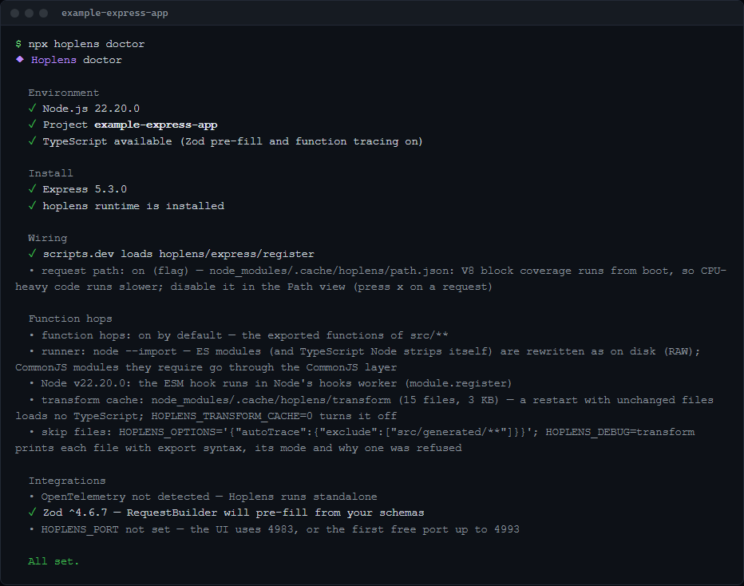

Run `npx hoplens <cmd> --help` for details.

## Safety

- **Dev only.** On Next, the instrumentation import is gated by `NODE_ENV === "development"` and the
  runtime refuses `NODE_ENV=production` without `HOPLENS_FORCE=1`; `withHoplens()` does nothing
  outside the dev phase. On Express the register hook is on when `NODE_ENV` is unset or
  anything but `production` / `test`, and off for those two unless `HOPLENS_FORCE=1`: with the gate
  off it patches nothing and never loads `@hoplens/core`.
- **Zero production impact.** CI builds the Next example and asserts the production output holds no
  Hoplens runtime (`pnpm --filter hoplens-e2e verify:build`). The helpers in `hoplens/trace` are
  no-ops without the runtime.
- **Loopback only.** Every route of the UI and API, SSE streams included, answers only callers on
  this machine that address it by a local name: the `Host` (and any `x-forwarded-host`) must be
  `localhost`, `*.localhost`, `127.x.x.x` or `[::1]`, and an `Origin`, when a browser sends one,
  must be local too. Anything else gets 403 `{ code: "forbidden" }`, which stops DNS rebinding and
  other sites. `POST` and `DELETE` from a browser must send `content-type: application/json`; a
  text/plain, form or multipart body gets 415 `{ code: "content-type" }`. The request path switch
  stays local even with `allowRemote`.
- **Redaction.** Authorization, cookies, passwords, tokens, API keys and card fields (plus your
  `redact` keys) are masked in captured headers, bodies, args and results before they are stored.
- **No network calls** from the UI or the runtime other than to your own app. The UI is one
  self-contained HTML file with no CDN or web fonts.

## HTTP API

Everything the UI shows comes from a JSON API under `/__hoplens/api` (also on the standalone port),
behind the guard above. Handy for scripts and tests.

| Endpoint | Returns |
|---|---|
| `GET /traces[?q=&since=]`, `GET /traces/:id`, `DELETE /traces` | Trace summaries, filtered by a query and/or an edit, one full trace, clear all |
| `GET /traces/:id/request` | The request as it can be sent again: method, URL, headers, raw body |
| `GET /stats[?buckets=1&since=]` | Per-route latency histograms, the findings rollup, error kinds, per-edit p50 deltas, example requests |
| `GET /queries[?kind=db\|cache\|fetch&limit=]` | Normalized query and host shapes with calls, p95, errors, routes and callers |
| `GET /compare?a=&b=`, `/compare/baselines`, `/compare/pins` | Span-level diff of two traces, baseline candidates, pins (`POST` / `DELETE /compare/pins/:id`) |
| `GET /epochs`, `/regressions`, `/epochs/events` (SSE) | Edits with files and affected routes, per-route verdicts, live feed |
| `GET /health`, `/health/stream` (SSE) | Event-loop delay, memory, GC and recorded process errors |
| `POST /run[?repeat=N]` | Send a request through your app; `repeat` (up to 50) runs it in sequence and reports warm p50 / p95 against the last batch |
| `POST /traces/:id/path`, `GET /traces/:id/path` | Trace path: replay a GET / HEAD once as a new trace and capture its path (errors as `{ code, error }`); read the analyzed path of that new trace |
| `POST /path/enable`, `POST /path/disable` | Write or remove the request path flag for the next start (409 `env` when `HOPLENS_PATH` is set) |
| `GET /events` (SSE) | `start` / `done` / `update` / `clear` per trace, plus `health` ticks |
| `GET /routes[?fresh]`, `/meta` | Discovered routes (`fresh` rescans), runtime info, including the request path state |
| `GET /source?file=&line=[&context=]` | A source excerpt (10 lines each side by default) with the file's hash |

## Repo layout

```text
packages/
  meta/        hoplens              unscoped meta: depends on cli, next, express, core
  cli/         @hoplens/cli         bin `hoplens` (init / doctor / remove)
  next/        @hoplens/next        withHoplens, Next route + proxy scanner, instrumentation entry
  express/     @hoplens/express     Express 4/5 adapter: register hook, hoplens(app), router tap
  core/        @hoplens/core        framework-neutral runtime, OTel bridge, findings, request path, API
  schema/      @hoplens/schema      static Zod reader, shared schema finder
  transform/   @hoplens/transform   exported-function rewriter, bundler loader, Node hooks, CommonJS layer
  ui/          @hoplens/ui          Preact + Vite single-HTML UI
examples/
  next16-app/                       Turbopack + proxy.ts + Zod v4 + pg, with seeded problems
  express-app/                      Express 5 (ESM) + pg + Zod v4 via hoplens/express/register, with seeded problems
e2e/                                Playwright suite, prod-build leak check, install-flow smoke
apps/web/                           hoplens.dev placeholder
docs/images/                        the screenshots in this README
```

## Development

```bash
pnpm install
pnpm build                                  # every package under packages/
pnpm test                                   # vitest in every package
pnpm typecheck
pnpm lint
pnpm --filter @hoplens/core bench           # the per-request pipeline must stay under 2 ms
pnpm --filter example-next16-app dev        # http://localhost:3000/__hoplens
pnpm --filter example-express-app dev       # http://localhost:3100/__hoplens
pnpm --filter example-express-app traffic   # send the seeded traffic
```

The runner matrix (spawned `node`, `-r`, tsx and ts-node processes) runs on its own:

```bash
pnpm --filter @hoplens/transform test:runners
pnpm --filter @hoplens/express test:runners
HOPLENS_TEST_NODE=/path/to/node-v20.9.0/bin/node pnpm --filter @hoplens/express test:runners   # on another Node
```

End-to-end checks (opt-in, slow):

```bash
pnpm --filter hoplens-e2e install:browsers   # one-time
pnpm --filter hoplens-e2e e2e                # Playwright screenshot suite
pnpm --filter hoplens-e2e verify:build       # prod build has no Hoplens leaks
pnpm --filter hoplens-e2e verify:install     # pack -> scratch install -> init -> doctor
```

Before changing a file, read [`AGENTS.md`](./AGENTS.md): it maps the architecture and lists the
hard-won lessons tied to specific files. Describe user-facing changes with `pnpm changeset`;
[`RELEASING.md`](./RELEASING.md) covers publishing.

## License

MIT (c) Hoplens contributors. See [LICENSE](./LICENSE).
