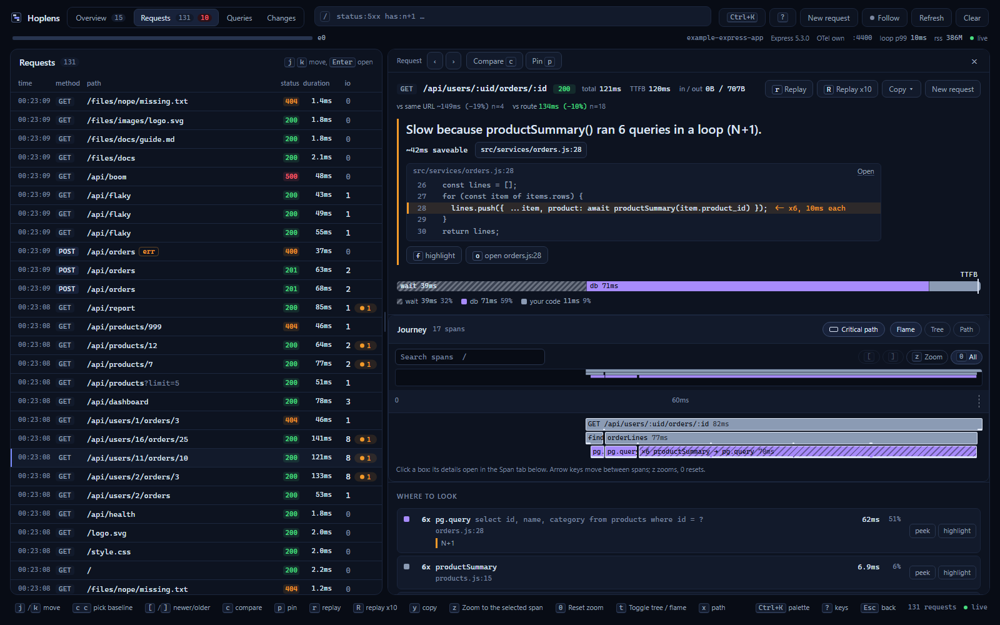

# hoplens

[](https://www.npmjs.com/package/hoplens)
[](https://github.com/hermandinho/hoplens/blob/main/LICENSE)

The request-journey visualizer for Node.js backends, for Next.js and Express. One
command, and your dev server (`next dev`, or your Express dev script) gains a
page at `/__hoplens` showing every request's full hop-by-hop journey — proxy or
route → handler → your functions → fetch/DB → response — with errors pinned to
the exact source line and a request builder that pre-fills bodies from your Zod
schemas.



Each request opens with one sentence saying what made it slow or fail and
the line to look at. Findings (N+1, duplicate calls, parallelizable chains,
uncached fetches, swallowed errors, …) are ranked across requests, every dev
rebuild (or, for Express, every watch restart) gets a per-route "did this edit
make it slower?" verdict, and any two requests can be compared span by span or
replayed ×10. With the request path on, **Trace path** replays a GET once and
shows which branch of each function it took. Dev responses carry
`Server-Timing` and `x-hoplens-trace` headers for the browser's Network panel.
Press `?` in the UI for the keys, `Ctrl/Cmd+K` for the command palette.

Options (`insights`, `serverTiming`, `persist`, …), the search language, the
keyboard map and the JSON API are documented in the
[repo README](https://github.com/hermandinho/hoplens#readme).

## Install

```bash
npm i -D hoplens
npx hoplens init     # Next.js: withHoplens() + instrumentation.register(); Express: the dev script
npm run dev
# open http://localhost:<your dev port>/__hoplens
```

`init` detects the framework from `package.json` (`--framework next|express`
when you depend on both):

- **Next.js:** wraps `next.config.*` in `withHoplens()` from `hoplens/next` and
  adds the dev-only `hoplens/node` import to `instrumentation.ts`'s
  `register()`, creating either file if missing.
- **Express:** adds `--import hoplens/express/register` to `scripts.dev` (else
  `start:dev`, else `watch`) and nothing else; `node [--watch]`, `tsx [watch]`
  and `nodemon` scripts are edited; for other runners it prints the line to use
  (ts-node, pm2) or what to change (docker, bun, ...).

In a terminal it then asks whether to turn on the request path (default no).

Requires Node 20.9+, and Next.js 15.3+ (Next 16 is the primary target) or
Express 4.18+ / 5 (`express >=4.18 <6`). Both are optional peer dependencies:
install the one your app uses.

## Commands

- `npx hoplens init` — wire into `next.config` and `instrumentation`, or the Express dev script (idempotent)
- `npx hoplens doctor` — check that everything is in place
- `npx hoplens remove` — reverse of `init` (byte-identical round-trip)

`init` and `remove` take `--dry-run`; all three take `--framework next|express`.
Run `npx hoplens <cmd> --help` for details.

## Entries

| Import | What it is |
|---|---|
| `hoplens` | `traced`, `step` and the `HoplensOptions` / `HoplensProfile` types (no `withHoplens`, no default export: use `hoplens/next`) |
| `hoplens/next` | `@hoplens/next`: `withHoplens()` for `next.config` |
| `hoplens/node` | `@hoplens/next/node`: the side-effect import for `instrumentation.ts` that boots the runtime |
| `hoplens/express` | `@hoplens/express`: `hoplens(app)` |
| `hoplens/express/register` | `@hoplens/express/register`: the preload for `node --import` / `-r` |
| `hoplens/trace` | `traced()`, `step()` and `drizzleLogger()` from `@hoplens/core/trace`, for code the auto-tracer can't reach; no-ops when the runtime isn't loaded |

Use these rather than the scoped packages: with pnpm, `@hoplens/express` and
`@hoplens/core` are not resolvable from your project.

## What ships

This meta-package pulls in:

- [`@hoplens/cli`](https://www.npmjs.com/package/@hoplens/cli) — the `hoplens`
  binary.
- [`@hoplens/next`](https://www.npmjs.com/package/@hoplens/next) — `withHoplens()`
  config wrap and the Next route scanner.
- [`@hoplens/express`](https://www.npmjs.com/package/@hoplens/express) — the
  Express 4/5 adapter: the register hook, function hops and `hoplens(app)`.
- [`@hoplens/core`](https://www.npmjs.com/package/@hoplens/core) — the
  framework-agnostic runtime that drives the UI.

For Nest / Fastify (planned), pair the direct adapter package with
`@hoplens/cli` instead.

## Dev-only guarantee

- **Next.js:** the instrumentation import is gated by
  `NODE_ENV === "development"`, and the production build is CI-asserted to
  contain zero Hoplens runtime.
- **Express:** the register hook starts Hoplens only when `NODE_ENV` is unset
  or anything but `production` / `test` (`HOPLENS_FORCE=1` overrides that). With
  the gate off it patches nothing and never loads the runtime. `doctor` fails a
  production-looking script that loads it.

`HOPLENS=0` turns it off everywhere.

## License

MIT. See the [repo](https://github.com/hermandinho/hoplens) for source and docs.
